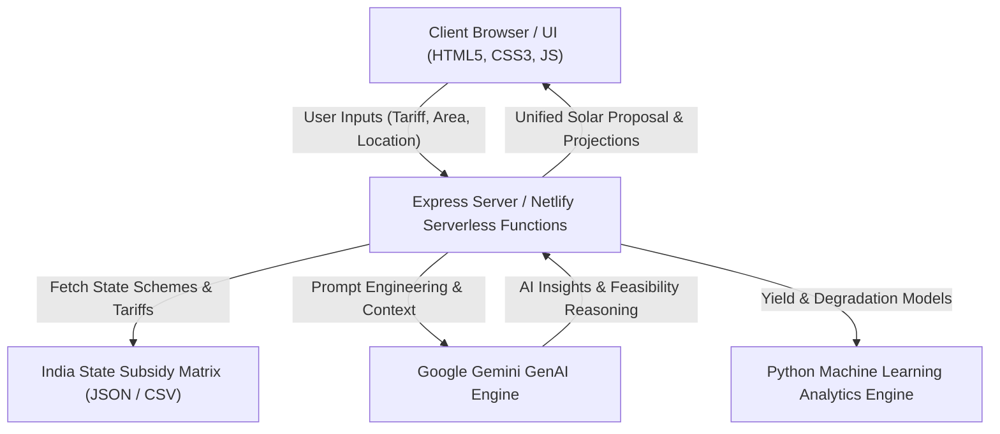

# ☀️ SolarWise AI — Intelligent Solar Energy Planning Advisor

[](https://opensource.org/licenses/MIT)
[](https://nodejs.org/)
[](https://deepmind.google/technologies/gemini/)
[](https://www.netlify.com/)

> **Next-generation CleanTech planning platform combining real-time solar yield modeling, state subsidy intelligence, and Google Gemini Generative AI for customized rooftop solar recommendations.**

---

## 📖 Table of Contents
- [Overview](#-overview)
- [Key Features](#-key-features)
- [System Architecture](#-system-architecture)
- [Tech Stack](#-tech-stack)
- [Project Structure](#-project-structure)
- [Getting Started](#-getting-started)
- [Environment Configuration](#-environment-configuration)
- [API Reference](#-api-reference)
- [Deployment](#-deployment)
- [Contributing](#-contributing)
- [License](#-license)

---

## 🌟 Overview

**SolarWise AI** solves the complexity of solar rooftop adoption for residential and commercial property owners across India. Traditional solar assessments require manual site visits and complex tariff calculations. SolarWise AI automates this workflow by synthesizing:

1. **Solar Insolation & Capacity Modeling**: Dynamic estimation of optimal kW installation capacity based on rooftop area and historical utility spend.
2. **Indian State Subsidy Engine (2026)**: Up-to-date subsidy matrices under PM Surya Ghar Muft Bijli Yojana and state-specific incentives.
3. **Interactive Financial & EMI Analytics**: Real-time payback periods, cumulative 25-year net savings, and dynamic financing calculators.
4. **Gemini AI Scenario Reasoning**: Real-time generative AI advisor that evaluates environmental conditions, feasibility checks, and tailored advice.

---

## ✨ Key Features

- **⚡ Instant Rooftop Feasibility Calculator**: Estimate system size (kW), required shadow-free area, and annual power generation (kWh).
- **🤖 Gemini AI Generative Advisor**: Integrates `@google/genai` to analyze user inputs, assess risks (shading, maintenance), and generate human-readable technical recommendations.
- **💰 Dynamic EMI & Cashflow Modeling**: Real-time calculation of loan tenures, interest rates, down payments, and net monthly cash flow impact.
- **📊 25-Year Life-Cycle Financial Projections**: Interactive charts detailing capital expenditure, government subsidies, degradation rates, and cumulative ROI.
- **☁️ Cloud & Serverless Ready**: Deployable as an Express.js service or on Netlify Serverless Functions with zero cold-start overhead.

---

## 🏗️ System Architecture



---

## 🛠️ Tech Stack

- **Frontend**: HTML5, Vanilla JavaScript (ES6+), CSS3 Grid & Flexbox, Chart.js for data visualization
- **Backend**: Node.js, Express.js (`server.js`), Serverless HTTP adapter (`serverless-http`)
- **AI & ML**: Google Gemini API (`@google/genai`), Python microservice (FastAPI / scikit-learn)
- **Deployment**: Netlify Functions (`netlify/functions/api.js`), Docker container support

---

## 📁 Project Structure

```text
solarwise-ai/
├── assets/                  # Application icons, graphics, and visual media
├── data/                    # Dataset benchmarks and solar irradiance tables
├── netlify/
│   └── functions/
│       └── api.js           # Serverless API endpoints for cloud deployment
├── python_service/          # Python ML prediction service for solar yield
│   ├── app.py
│   └── train_model.py
├── .env.example             # Template for required environment variables
├── index.html               # Multi-step responsive web application interface
├── netlify.toml             # Netlify deployment and route configuration
├── package.json             # Node dependencies and build scripts
├── script.js                # Core frontend controller and reactive state logic
├── server.js                # Express REST API backend
├── style.css                # Polished design system and responsive styles
└── LICENSE                  # MIT Open Source License
```

---

## 🚀 Getting Started

### Prerequisites
- [Node.js](https://nodejs.org/) (v18.0.0 or higher)
- [npm](https://www.npmjs.com/) (v9.0.0 or higher)
- [Python 3.10+](https://www.python.org/) *(optional, for Python ML microservice)*
- Google Gemini API key from [Google AI Studio](https://aistudio.google.com/)

### Installation

1. **Clone the repository:**
   ```bash
   git clone https://github.com/MahirMavani/SolarWiseAI.git
   cd SolarWiseAI
   ```

2. **Install Node.js dependencies:**
   ```bash
   npm install
   ```

3. **Configure Environment Variables:**
   ```bash
   cp .env.example .env
   ```
   Add your Google Gemini API key inside `.env`:
   ```env
   GEMINI_API_KEY=your_gemini_api_key_here
   PORT=3000
   ```

4. **Start the local development server:**
   ```bash
   npm start
   ```
   Open your browser at `http://localhost:3000`.

---

## 🔌 API Reference

### Health Check
```http
GET /api/health
```
Response:
```json
{
  "status": "healthy",
  "timestamp": "2026-10-28T18:00:00.000Z"
}
```

### Solar Assessment & Gemini Reasoning
```http
POST /api/assess
```
Request Body:
```json
{
  "monthlyBill": 4500,
  "rooftopArea": 650,
  "state": "Gujarat",
  "consumerType": "residential"
}
```

---

## 🚢 Deployment

### Deploy to Netlify
1. Connect your repository to Netlify.
2. Ensure the build command is configured:
   - **Build Command**: `npm install`
   - **Publish Directory**: `.`
   - **Functions Directory**: `netlify/functions`
3. Add `GEMINI_API_KEY` under **Site Settings > Environment Variables**.

---

## 🤝 Contributing

Contributions, issues, and feature requests are welcome!
1. Fork the Project.
2. Create your Feature Branch (`git checkout -b feature/AmazingFeature`).
3. Commit your Changes (`git commit -m 'feat: add amazing feature'`).
4. Push to the Branch (`git push origin feature/AmazingFeature`).
5. Open a Pull Request.

---

## 📄 License

Distributed under the **MIT License**. See [`LICENSE`](LICENSE) for details.

---

**Developed with 💡 and passion by [Mahir Mavani](https://github.com/MahirMavani).**
